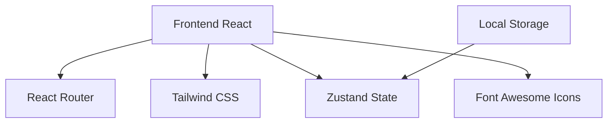

## 1. Architecture Design


## 2. Technology Description
- **Frontend**: React@18 + TypeScript + Tailwind CSS@3 + Vite
- **State Management**: Zustand
- **Routing**: React Router DOM
- **Icons**: Lucide React
- **Styling**: Tailwind CSS + Custom CSS Animations
- **Editor**: Simple code editor with syntax highlighting
- **Storage**: Local Storage for progress tracking

## 3. Route Definitions
| Route | Purpose |
|-------|---------|
| / | Home page with hero and categories |
| /questions | Questions list with filters |
| /question/:id | Question detail with answer interface |
| /progress | Learning progress and statistics |

## 4. Data Model
### 4.1 Question Model
```typescript
interface Question {
  id: string;
  title: string;
  category: string;
  difficulty: 'easy' | 'medium' | 'hard';
  tags: string[];
  description: string;
  codeTemplate?: string;
  solution: string;
  explanation: string;
}
```

### 4.2 Progress Model
```typescript
interface Progress {
  questionId: string;
  completed: boolean;
  attempts: number;
  lastAttempt: Date;
}
```

### 4.3 Category Model
```typescript
interface Category {
  id: string;
  name: string;
  icon: string;
  color: string;
  description: string;
  count: number;
}
```
