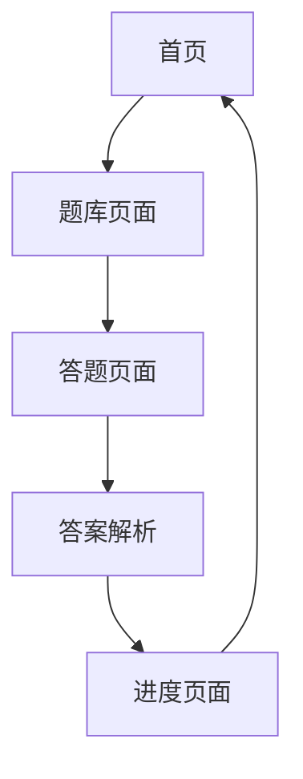

## 1. Product Overview
人工智能/计算机岗位面试刷题平台，提供炫酷的视觉效果和流畅的交互体验，支持手机/平板/PC多平台访问。
- 帮助用户准备AI和计算机岗位面试，通过刷题提升专业技能
- 面向求职者、学生和技术人员，提供高质量的面试题库

## 2. Core Features

### 2.1 Feature Module
1. **首页**: 炫酷hero区域、题库分类导航、热门题目推荐
2. **题库页面**: 题目列表、分类筛选、难度筛选
3. **答题页面**: 题目展示、代码编辑器、答案解析
4. **进度页面**: 学习统计、完成记录、成就系统

### 2.3 Page Details
| Page Name | Module Name | Feature description |
|-----------|-------------|---------------------|
| 首页 | Hero区域 | 动态渐变背景、粒子效果、3D动画标题 |
| 首页 | 题库分类 | 卡片式分类展示、悬停动画效果 |
| 题库页面 | 筛选功能 | 分类、难度、标签多重筛选 |
| 答题页面 | 代码编辑器 | 语法高亮、主题切换 |
| 答题页面 | 答案解析 | 展开/收起、分步讲解 |
| 进度页面 | 统计图表 | 环形进度、柱状图展示 |

## 3. Core Process
用户访问首页 → 选择题目分类 → 浏览题目列表 → 开始答题 → 查看答案解析 → 记录学习进度

## 4. User Interface Design
### 4.1 Design Style
- **主色调**: 深科技蓝 (#0f172a) + 亮青色 (#06b6d4) + 霓虹粉 (#ec4899)
- **按钮风格**: 玻璃拟态、圆角设计、霓虹发光效果
- **字体**: 标题用Space Grotesk，正文用JetBrains Mono
- **布局风格**: 卡片网格、玻璃质感、层次叠加
- **动画风格**: 流畅过渡、悬停效果、加载动画

### 4.2 Page Design Overview
| Page Name | Module Name | UI Elements |
|-----------|-------------|-------------|
| 首页 | Hero区域 | 深色背景、动态渐变、粒子漂浮、打字机效果 |
| 首页 | 分类卡片 | 玻璃拟态卡片、图标、渐变边框、悬停上浮 |
| 题库页面 | 题目列表 | 卡片式布局、难度标签、进度指示器 |
| 答题页面 | 编辑器 | 深色主题、语法高亮、行号显示 |
| 进度页面 | 数据图表 | 彩色圆环、柱状图、数据标签 |

### 4.3 Responsiveness
- 响应式设计，适配手机、平板、PC
- 移动端垂直布局，桌面端水平布局
- 触摸友好的交互设计

### 4.4 Visual Effects
- 玻璃拟态(Glassmorphism)设计
- 霓虹发光边框效果
- 粒子背景动画
- 流畅的页面过渡动画
